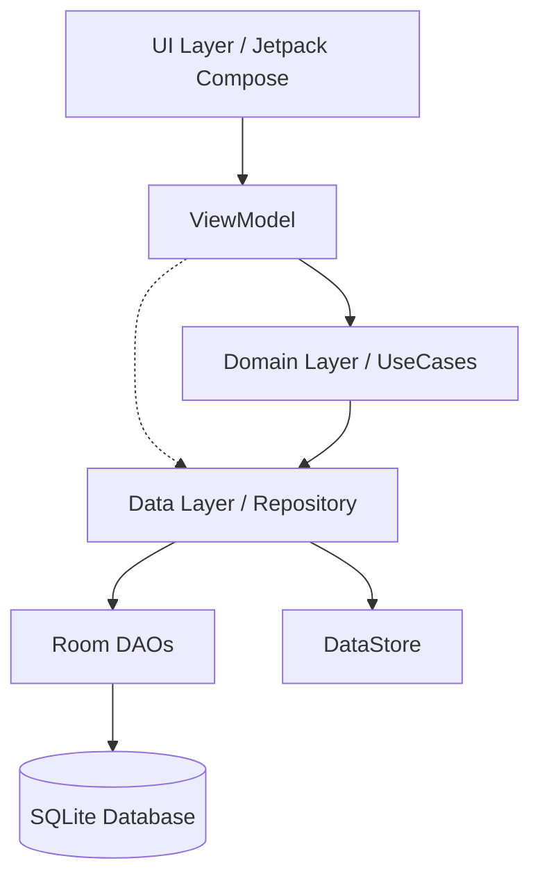
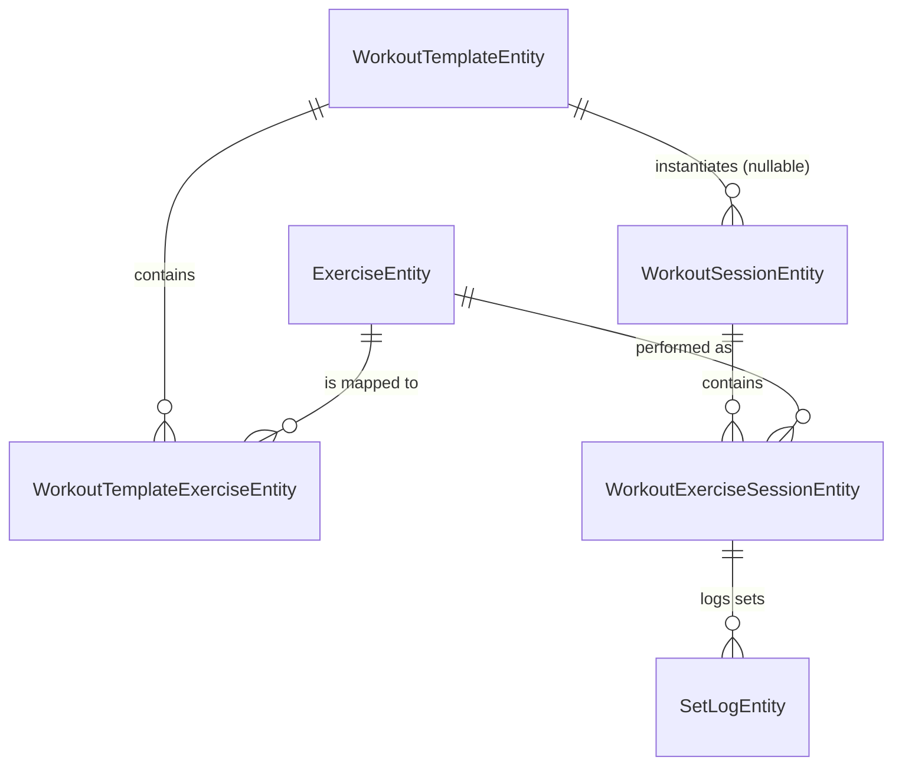

# FitPilot Beta - Master Project Documentation

This document serves as the absolute source of truth for the current architecture, features, and design system of the FitPilot Beta project.

## 1. Project Overview & Tech Stack

**FitPilot Beta** is a highly capable, offline-first Android application geared towards smart coaching, fitness tracking, and nutrition planning. Its offline-first philosophy ensures rapid, resilient operation without strict internet dependency for daily logging, while seamlessly integrating optional AI recommendations and JSON-based program syncing.

### Core Tech Stack
* **Language**: Kotlin 2.0.20 (with JDK 17 target compatibility).
* **UI Framework**: Jetpack Compose (Material 3).
* **Architecture**: Clean Architecture / MVVM.
* **Local Persistence**:
  * Room Database (v2.6.1) with rigorous relational mapping (`GymFlowDatabase`).
  * DataStore Preferences (v1.1.1) for settings and global targets (`ProfileDataStore`, `WorkoutSettingsDataStore`, `AiSettingsDataStore`).
* **Dependency Injection**: Hilt (v2.51.1).
* **Serialization**: Kotlinx.Serialization for high-performance JSON parsing.
* **Testing/Tooling**: JUnit 4, Robolectric, Coroutines Test, Espresso.

---

## 2. Architecture (Clean Architecture & MVVM)

The project heavily adheres to the Clean Architecture pattern, dividing responsibilities strictly into three layers.

### Mermaid Data Flow Diagram



### Module / Package Structure
* **UI Layer (`com.doruk.fitprogress.ui` & `feature`)**: Jetpack Compose screens and ViewModels. ViewModels observe domain states and trigger Intent-like actions.
* **Domain Layer (`com.doruk.fitprogress.core.domain`)**: Holds the business logic (UseCases like `ImportProgramUseCase`, `CalculateProgressionUseCase`). The models here (`ProgramPlanDto`, `ActiveWorkoutSession`) represent pure, decoupled domain objects.
* **Data Layer (`com.doruk.fitprogress.core.data` & `database`)**: Responsible for mapping Entities (`WorkoutTemplateEntity`, etc.) and abstracting the DAO operations.
* **Recent Refactor Note**: ViewModels no longer directly inject DAOs where avoidable; they go through repositories and specialized UseCases to maintain strict layer boundaries and improve testability.
* **Dependency Injection**: Hilt modules (e.g., `DatabaseModule.kt`) wire the App, providing singleton DAOs, `GymFlowDatabase`, and DataStores.

---

## 3. Local Data Storage & Database Schema

The persistence layer is deeply normalized, relying heavily on Foreign Key constraints and indices for optimal query performance.

### Room Database (`GymFlowDatabase`) - Core Entities
* `WorkoutTemplateEntity`: The blueprint for a day's workout (`id`, `name`, `dayCode`, `isAiProgram`). Note: Migration v8 added `isAiProgram` (Boolean) to flag AI-generated templates.
* `WorkoutTemplateExerciseEntity`: Joins a Template to an Exercise with parameters (target sets, reps, load, rest, RPE). FK linked to `WorkoutTemplateEntity` and `ExerciseEntity`.
* `ExerciseEntity`: Core dictionary of exercises (`id`, `name`, `muscleGroup`, `movementType`, `defaultRestSeconds`).
* `WorkoutSessionEntity`: Logs a specific executed instance of a template (`id`, `startedAt`, `finishedAt`, `totalWorkingVolumeKg`).
* `WorkoutExerciseSessionEntity`: The junction mapping an executed exercise session to the parent workout session.
* `SetLogEntity`: Granular tracking of individual sets (`setNumber`, `setType` [WARMUP/WORKING], `actualWeight`, `actualReps`, `completed`).

### Schema Relationships Diagram



* **Indices & Performance:** To prevent full table scans on cascading deletions and fast lookups, heavy indexing is used. Specifically, crucial indices have been added for `SetAdviceEntity` (e.g., `@Index("setLogId")`) and `AdaptiveCardioRecommendationEntity` (e.g., `@Index("workoutSessionId")`) to optimize fetching coaching recommendations and adaptive plans associated with specific workout instances.
* **Smart Coaching Entities:** `SetAdviceEntity`, `AdaptiveCardioRecommendationEntity`, and `ProgressionSuggestionEntity` map deeply to active session and set logs to inject contextual guidance.

### DataStores
1. `ProfileDataStore`: Global user goals and athlete profile (e.g., `target_calories`, `target_protein`, `daily_steps_target`).
2. `WorkoutSettingsDataStore`: User experience preferences (`timer_sound_enabled`, `app_theme_mode`, `timer_sound_style`).
3. `AiSettingsDataStore`: Secure, encrypted storage for `gemini_api_key` using AndroidX Security, plus flags for AI enabling and logging.

---

## 4. Core Features & Business Logic

### AI Coach JSON Integration
The app parses highly structured JSON programs generated by the AI Coach via the clipboard using `Kotlinx.Serialization`.
* `ImportProgramUseCase` (or equivalent like `SyncCoachPlanUseCase`): Decodes the JSON to `ProgramPlanDto`, overwrites user nutritional targets in `ProfileDataStore`, clears old AI templates, and inserts new ones.
* `ExportProgramToJsonUseCase`: Packages current templates into the identical JSON schema and pushes it to the clipboard.

**Target Multi-Day JSON Schema Snippet:**
```json
{
  "programVersion": "2.1",
  "athlete": "John Doe",
  "dailyNutritionTarget": {
    "calories": 2500,
    "proteinGrams": 150,
    "fatGrams": 80,
    "carbsGrams": 250,
    "dailyStepsTarget": 8000,
    "sleepHoursTarget": 8.0
  },
  "workouts": [
    {
      "dayNumber": 1,
      "workoutName": "Upper Body Power",
      "exercises": [
        {
          "id": "ex_bench_press",
          "name": "Barbell Bench Press",
          "targetSets": 4,
          "targetRepsMin": 4,
          "targetRepsMax": 6,
          "targetLoad": 100.0,
          "restTimerSeconds": 120
        }
      ]
    }
  ]
}
```

### Active Workout Flow
* **State Management**: Handled primarily via `ActiveWorkoutViewModel`, storing the active footprint in an `ActiveWorkoutSession` domain model.
* **Working vs. Warm-up Sets**: Strictly differentiated in domain and DB models. Warm-ups don't count towards the `totalWorkingVolumeKg` progression metrics.
* **Rest Timer HUD**: Driven by Coroutines (`timerJob`). Emits alert states (Beep, Vibration) at specific intervals depending on `TimerSoundStyle` configurations in `WorkoutSettingsDataStore`.

---

## 5. UI/UX Design System (Material 3)

The app leverages a modern Compose approach mapped to the following specifications:

### Color Palette
* **Backgrounds/Surfaces**: Dark Slate/Obsidian.
* **Accents (Primary/Secondary)**: Electric Cobalt, Athletic Emerald.
* **Warnings**: Warm Amber.

### Typography & Performance Best Practices
* **Typography**: Specifically incorporates `tabular figures` (`tnum`) for metrics. This ensures that live numbers (like timers and volume counters) do not jump around horizontally when the digits change, maintaining visual stability.
* **Performance Best Practices**:
  * Extensive use of `collectAsStateWithLifecycle()` to prevent memory leaks and UI updates when the app is backgrounded.
  * Ensures that stable `key` parameters are provided in `LazyColumns` (e.g., using item IDs) so that Compose can intelligently diff the list contents, preventing full recompositions when list items are inserted, deleted, or reordered.

---

## 6. Legacy Workarounds & Constraints

### MojibakeMigrationUtils
Due to seeded data corruption occurring during previous database initializations (character encoding failures), `MojibakeMigrationUtils` exists to manually scan and correct corrupted strings.

**Why not a standard Room Migration?**
A standard Room migration (`ALTER TABLE`) cannot programmatically search-and-replace specific string substrings (`\u00E2\u20AC\u201D` -> `\u2014`) dynamically across all rows. Therefore, this utility runs as an idempotent Coroutine task on ViewModel init.
**Constraint:** *This logic must be preserved and not removed during standard refactors.*

```kotlin
val badSequence = "\u00E2\u20AC\u201D"
val goodSequence = "\u2014"
templates.filter { it.id.startsWith("tpl_") && it.name.contains(badSequence) }
    .forEach { template ->
        val repaired = template.copy(name = template.name.replace(badSequence, goodSequence))
        dao.insertTemplates(listOf(repaired))
    }
```

### CI/CD Workflow
The repository utilizes a GitHub Actions workflow triggered upon pushing to the `main` branch.
* **Purpose**: Automatically generates the APK (`assembleDebug`).
* **Release Management**: Overwrites the `latest-apk` tag in GitHub Releases with the newly compiled `app-debug.apk`.
