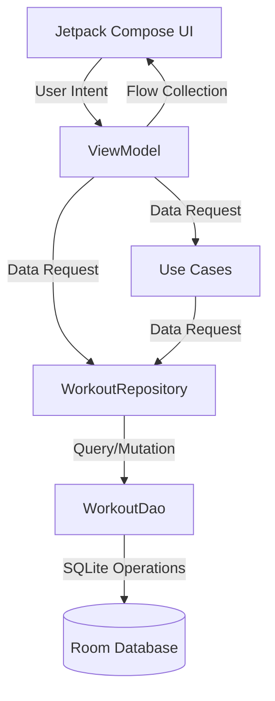
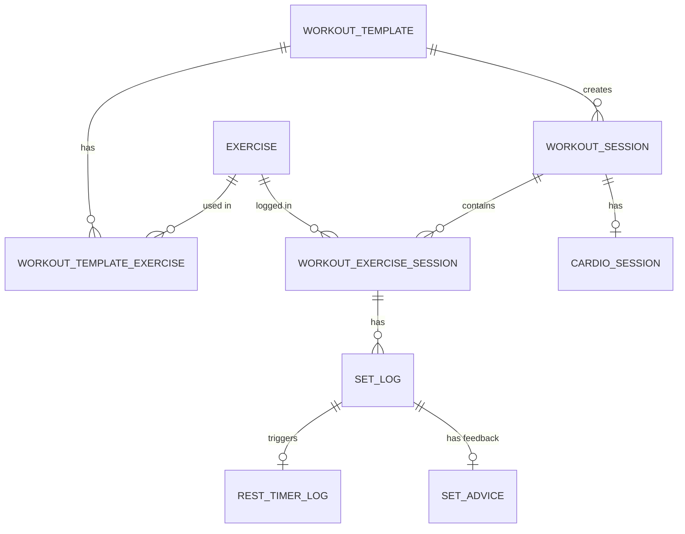

# FitPilot Beta - Master Project Documentation

This document serves as the absolute source of truth for the FitPilot Beta Android application's architecture, data layer, UI system, and core features.

## 1. Project Overview & Tech Stack
**FitPilot Beta** is a highly-optimized, offline-first personal training and workout logging Android application. Designed to be robust even without network availability, the application relies heavily on structured local data storage to manage templates, active workout states, telemetry, and nutrition tracking.

### Tech Stack
* **Language:** Kotlin
* **UI Toolkit:** Jetpack Compose (Material 3)
* **Local Database:** Room Database (`GymFlowDatabase`)
* **Dependency Injection:** Dagger Hilt
* **Data Serialization:** `kotlinx.serialization` (JSON)
* **Preferences/Key-Value Storage:** Android DataStore (`Preferences DataStore`)
* **Asynchronous Execution:** Kotlin Coroutines & Flow

---

## 2. Architecture (Clean Architecture & MVVM)

The project strictly follows Clean Architecture combined with the MVVM (Model-View-ViewModel) presentation pattern.

### Data Flow Diagram



### Dependency Injection & Repository Pattern
A strict separation of concerns is maintained. ViewModels do **not** interact directly with the Room DAOs. Instead, they interact with the `WorkoutRepository` interface (implemented by `WorkoutRepositoryImpl`), ensuring the UI layer is isolated from the data source implementations.
* **Hilt Setup:** The repository layer is injected via `RepositoryModule`, and Room DAOs/Database are provided via `DatabaseModule`.
* Example: `ActiveWorkoutViewModel` relies on `WorkoutRepository` for atomic session initializations and updates, decoupling it entirely from the underlying SQLite operations.

---

## 3. Local Data Storage & Database Schema

The core persistence layer is handled by `GymFlowDatabase` (Room), currently running at `version = 7`.

### Entity-Relationship Diagram (Core Entities)



### Core Entities & Indices
* **`WorkoutTemplateEntity`**: Defines templates with specific day codes and focus areas.
* **`ExerciseEntity`**: Core exercise dictionary defining equipment, movement types, and tracking defaults.
* **`WorkoutSessionEntity`**: Represents an actively tracked or completed workout instance. References `templateId` (indexed).
* **`WorkoutExerciseSessionEntity`**: Links a session to an exercise. Foreign keys to `workoutSessionId` and `exerciseId` are explicitly indexed.
* **`SetLogEntity`**: Tracks individual sets (weight, reps, RPE, skipped status). Foreign key to `workoutExerciseSessionId` is explicitly indexed.
* **`CardioSessionEntity`**: Tracks cardio appended to a workout. Foreign key to `workoutSessionId` is explicitly indexed.
* **`SetAdviceEntity` & `AdaptiveCardioRecommendationEntity`**: AI telemetry tables tracking session adjustments, explicitly indexing their foreign keys (`setLogId` and `workoutSessionId`).

### DataStores
* **`WorkoutSettingsDataStore`**: Manages granular preferences for the HUD Rest Timer (Sound Enable/Disable, Vibration, 30s Warnings, Sound Styles like `SOFT_BEEP` vs `CLEAR_TONE`).
* **`AiSettingsDataStore`**: Controls the user's preference for Gemini AI summarizations.

*(Note: DataStores are built with `androidx.datastore.preferences.core.Preferences`.)*

---

## 4. Core Business Logic & Features

### AI Coach JSON Integration (Import/Export)
The app supports multi-day program sharing via the system Clipboard using `SyncCoachPlanUseCase` and `ExportSessionToJsonUseCase`.

**Target JSON Schema (`CoachWorkoutPlanDto`):**
```json
{
  "workoutName": "Upper Body Power",
  "dayCode": "AI_COACH",
  "dayFocus": "Hypertrophy",
  "exercises": [
    {
      "id": "ex_bench_press",
      "name": "Barbell Bench Press",
      "targetSets": 4,
      "targetRepsMin": 8,
      "targetRepsMax": 12,
      "targetLoad": 80.0,
      "targetRpe": 8.0,
      "restTimerSeconds": 120
    }
  ],
  "notes": "Focus on eccentric control."
}
```
`SyncCoachPlanUseCase` parses this JSON (ignoring unknown keys safely) via `kotlinx.serialization`. It safely maps the payload to an "AI_COACH" dummy template, clearing old data to overwrite the day.

### Active Workout Flow
* **State Management:** Uses an atomic initialization strategy via `initializeWorkoutSession` mapping template data into an active session.
* **Rest Timer:** Embedded in the Compose `Scaffold` bottom bar. Powered by a decoupled `TimerAlertManager` that handles background alarms, TTS, and custom chime tones.
* **Working vs Warm-up Sets:** Warm-ups are structurally distinct and do not count toward total working volume (`totalWorkingVolumeKg`).

---

## 5. UI/UX Design System (Material 3)

### Color Palette
FitPilot utilizes a sleek, dark-themed, high-contrast aesthetic:
* **Backgrounds:** `DeepNavy` (#0A0E17) and `DarkCharcoal` (#151A22).
* **Primary Accents:** `ElectricCyan` (#00E5FF) and `VividViolet` (#7C4DFF).
* **Status Elements:** `NeonGreen` (#00E676) for success/completion, `AmberWarning` (#FFC400) for warnings, and `CoralRed` (#FF5252) for failures/skips.

### Typography
The application uses the `androidx.compose.material3.Typography` scale utilizing geometric sans-serif fonts. Weight distribution leans toward `SemiBold` and `Bold` for headers, creating clear visual hierarchies.

### Compose Performance Best Practices
* **State Collection:** The project mandates `collectAsStateWithLifecycle()` from `androidx.lifecycle.compose` rather than the standard `collectAsState()`, ensuring Flows do not run redundantly when the UI is in the background.
* **List Keys:** All `LazyColumn` items explicitly define a stable `key` parameter to prevent excessive and unnecessary recompositions during state updates.

---

## 6. Legacy Workarounds & CI/CD

### `MojibakeMigrationUtils`
This file is a vital, hardcoded legacy workaround.
* **Purpose:** Fixes corrupted string sequences (`—` to `—`) in seeded database templates caused by a historical encoding error during the initial `DatabaseSeeder` load.
* **Constraint:** This is executed as an idempotent Coroutine task upon database creation. It **must not** be altered or deleted.

### GitHub Actions (CI/CD)
The project utilizes a `.github/workflows/build-apk.yml` pipeline.
* **Trigger:** Pushes to the `main` branch.
* **Action:** Compiles the project using `./gradlew assembleDebug`.
* **Deployment:** Automatically pushes the resulting `app-debug.apk` to the GitHub Releases page under the `latest-apk` tag, dynamically overwriting the previous iteration to maintain a continuous distribution link.
